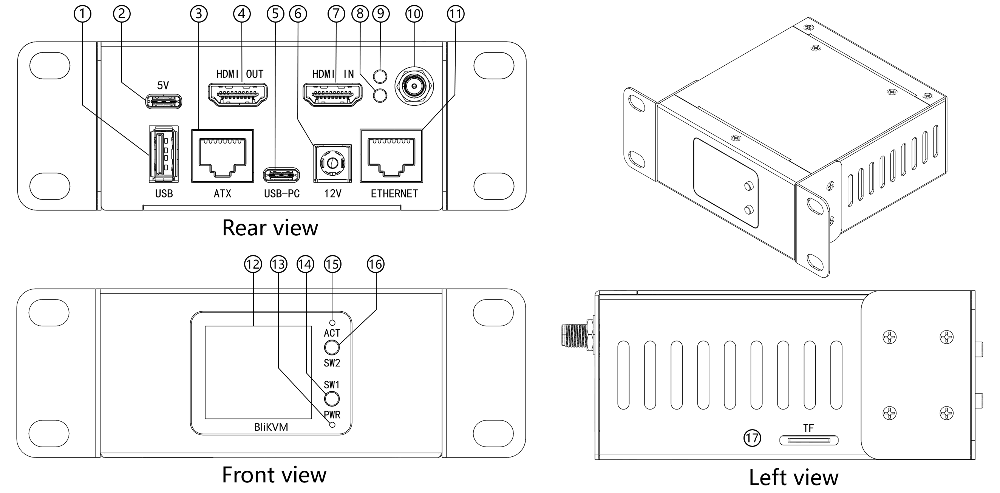
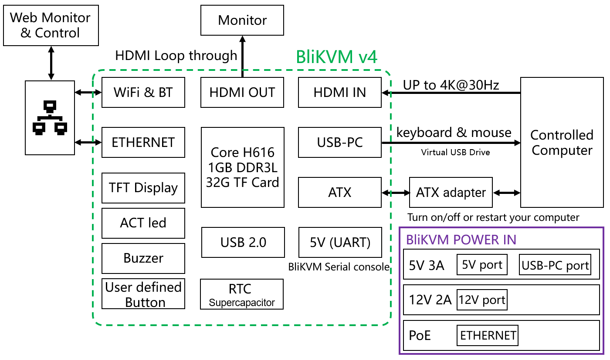

import useBaseUrl from '@docusaurus/useBaseUrl';

# BliKVM v4 Allwinner (H616/H313 SOC)

## **接口定义**

| 1 | USB 2.0        | 10   | 天线接口           |
| ----- | ------------------------------- | ---- | ----------------------------- |
| 2     | 供电口 5V 3A & UART      | 11   | 网口 100M & PoE |
| 3     | ATX 控制端口     | 12   | 1.33寸LCD屏幕 |
| 4     | HDMI 视频环出端口 | 13   | 供电指示灯 (红色)      |
| 5     | USB-PC              | 14   | 用户自定义按钮  |
| 6     | 供电口 12V 2A 5.5*2.1mm     | 15   | 状态指示灯 (绿色) |
| 7     | HDMI 视频输入端口   | 16 | 屏幕显示按钮 |
| 8     | HDMI 输入指示灯 (绿色) | 17   | Micro SD 卡槽         |
| 9     | HDMI 输出指示灯 (黄色) |      |                               |

## **参数**

| 参数名称         | 描述                                      |
| ---------------- | ----------------------------------------- |
| **供电**         |                                           |
| 5V 3A            | 5V 端口, USB-PC 端口                      |
| 12V 2A           | 12V DC端口                                |
| PoE              | 以太网供电 (IEEE802.3af协议)  48V DC       |
|                  |                                           |
| **端口**         |                                           |
| HDMI-IN          | HDMI 视频输入端口                         |
| HDMI-OUT         | HDMI 视频环出端口                         |
| USB-PC           | 模拟键盘，鼠标，大容量存储器或其他USB设备 |
| ATX              | 开关机被控电脑，读取被控电脑状态指示灯    |
| WiFi&BT          | IEEE802.11 b/g/n + BLE4.2                 |
| Micro SD 卡槽    | 安装镜像内存卡                            |
| 5V port          | 5V 3A 电源或串行控制台管理端口            |
|                  |                                           |
| **显示和指示灯** |                                           |
| LED指示灯        | 电源指示灯，状态指示灯，HDM输入输出指示灯 |
| 显示屏           | 1.33寸 TFT 彩色屏幕                       |
| 用户自定义按钮  | SW1                                       |
| 蜂鸣器           | Find me                                   |
|                  |                                           |
| **视频**         |                                           |
| 分辨率           | 最高支持4k@30Hz                           |
| 编码格式         | H264/MJPEG                                     |
|                  |                                           |
| **核心**         |                                           |
| 芯片             | 全志 H616/H313                                 |
| RAM              | 1GB                                       |
|                  |                                           |
| 功耗             | 最高15W                                   |
|                  |                                           |
| **环境参数**     |                                           |
| 工作温度         | 0°C to 70°C                               |
| 存储温度         | -20°C to 60°C                             |
|                  |                                           |
| **尺寸和重量**   |                                           |
| 尺寸             | 100 (L) x 134 (W) x 44.4 (H) mm           |
| 重量             | 0.45 kg                                   |

## **外形尺寸**

